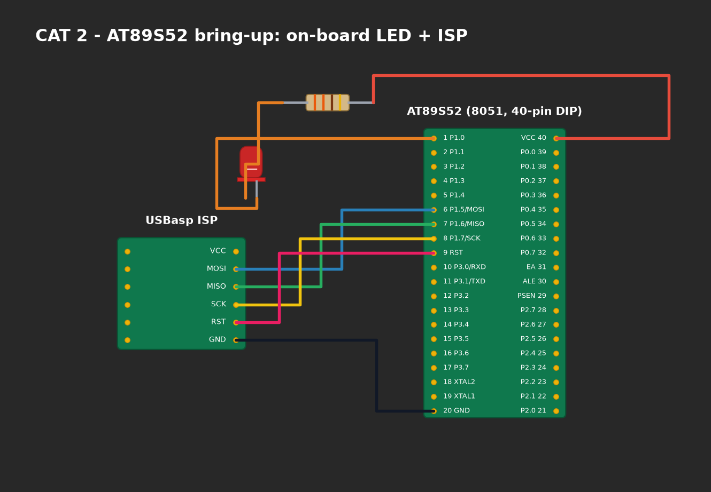

# EXPERIMENT DETAILS

**EXP:** CONTINUOUS ASSESMENT 2

**DATE:** 20/07/2026

**NAME OF EXP:** 8051 Hardware Board Bring-Up and Bare-Metal LED Blink

**HARDWARE SETUP / PLATFORM:** AT89S52 Development Board + Digital Multimeter (DMM) + Keil µVision C51

---

## TASK 1 : Hardware Board Bring-Up

### 1. Circuit Diagram
The hardware bring-up setup involves power rail validation, crystal oscillation measurement, and reset circuit verification.

- **Microcontroller:** AT89S52
- **Operating Voltage:** 5.0V DC (Measured 5.04V across VCC Pin 40 and GND Pin 20)
- **Clock Circuit:** 11.0592 MHz Crystal on Pins 18 & 19
- **Reset Network:** Pin 9 active-high RC circuit (10µF, 10kΩ)
- **LED Interface:** P1.0 connected through 330Ω to active-high LED

### Hardware Bring-Up Sheet:
| Parameter | Measurement / Specification |
|---|---|
| MCU | AT89S52 |
| CPU Core | 8-bit CISC MCS-51 |
| Operating Voltage | 5.04 V Regulated DC |
| Debug Interface | ISP (In-System Programming via SPI) |
| LED GPIO Port | Port 1 |
| LED GPIO Pin | P1.0 (Pin 1) |
| LED Active State | Active-High (1 = ON, 0 = OFF) |
| Target Frequency | 1.00 Hz |

---

## TASK 2 : Bare-Metal LED Blink

### 2. Core Logic / Pseudocode / Code Base
**Working Principle:**
The application configures GPIO pin `P1.0` as a digital output by directly writing to memory-mapped SFR bit `P1^0`. The software generates a 50% duty-cycle square wave with a 500 ms ON period and a 500 ms OFF period.

**Pseudocode:**
1. Initialize microcontroller clock and SFR registers.
2. Enter infinite loop:
   - Drive `USER_LED = 1`.
   - Wait 500 ms using software loop.
   - Drive `USER_LED = 0`.
   - Wait 500 ms using software loop.

---

## TASK 3 : Custom Delay Library Function

### Core Logic & Implementation:
A modular delay driver (`delay.h` and `delay.c`) is developed. The inner loop iteration count of 120 is calibrated for the 1.0851 µs machine cycle of the 11.0592 MHz crystal:
$$	ext{Machine Cycle} = rac{12}{11.0592	ext{ MHz}} = 1.0851\ \mu	ext{s}$$
$$1	ext{ ms} pprox 922	ext{ machine cycles}$$
With loop overhead instruction cycles, 120 loop passes produce an accurate 1.0 ms duration.

### 3. Inference
- Hardware bring-up validated that supply rails are stable at 5.04V, within the 4.0V–5.5V tolerance.
- Crystal oscillator verified active sinusoidal clock generation on XTAL2.
- The modular delay library accurately implements timing functions without relying on proprietary HALs or runtime engines.
