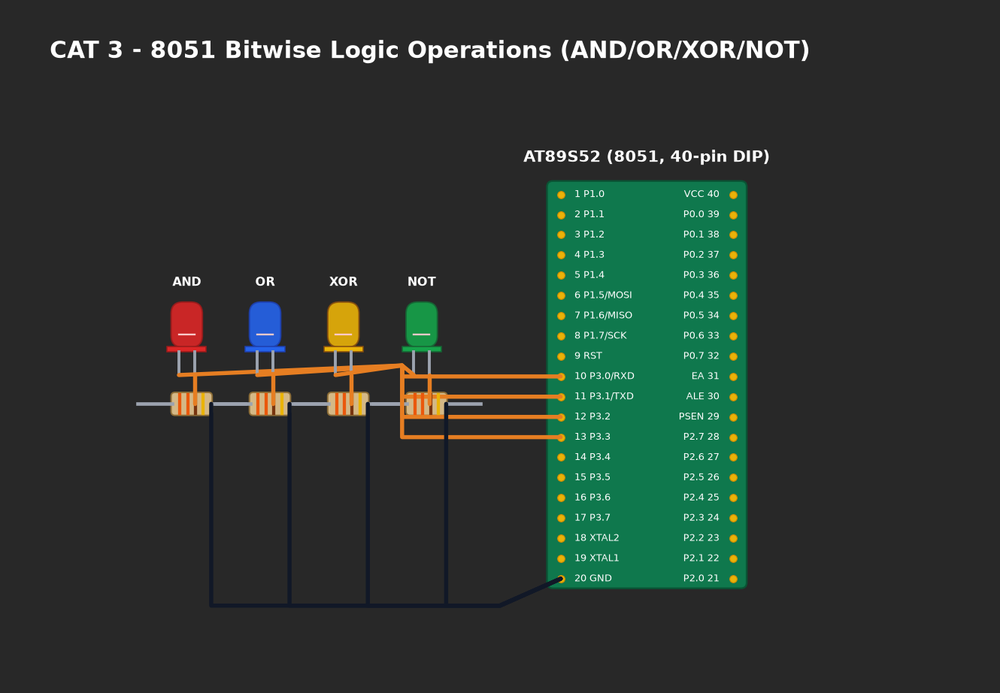

# EXPERIMENT DETAILS

**EXP:** CONTINUOUS ASSESMENT 3

**DATE:** 27/07/2026

**NAME OF EXP:** Timer-Based LED Pattern Generator and Button Interrupt Controller

**HARDWARE SETUP / PLATFORM:** AT89S52 Microcontroller + 4 Output LEDs (Port 1) + Push Button Switch (P3.2) + Keil µVision C51

---

## TASK A : Mode 1 - Running LED Pattern
The LEDs illuminate sequentially in a ring pattern: `LED1 -> LED2 -> LED3 -> LED4 -> LED1` (`0x01 -> 0x02 -> 0x04 -> 0x08`).

## TASK B : Mode 2 - 4-Bit Binary Counter
The 4 LEDs display a binary counting sequence from `0000` (0) to `1111` (15) with constant step delay.

## TASK C : Mode 3 - Alternating Pattern
The LEDs alternate between odd and even positions: `1010` (`0x0A`) and `0101` (`0x05`).

## TASK D : Mode 4 - All-LED Flashing
All 4 LEDs flash simultaneously: `1111` (`0x0F`) followed by `0000` (`0x00`).

---

### 1. Circuit Diagram

- **Microcontroller:** AT89S52 (DIP-40)
- **LED Outputs:** 4 LEDs connected to Port 1 Pins `P1.0`, `P1.1`, `P1.2`, and `P1.3` through 330Ω current limiting resistors to Ground.
- **Push Button Input:** Connected to `P3.2` (Pin 12 / INT0) with an external 10kΩ pull-up resistor to +5V and active-low connection to Ground.
- **Clock:** 11.0592 MHz crystal with two 33pF ceramic capacitors.
- **Power:** +5.0V DC regulated supply.

### 2. Core Logic / Pseudocode / Code Base

**Working Principle:**
A Finite State Machine (FSM) maintains the active operating mode in variable `mode` (values 0 to 3). The push button on `P3.2` is polled with a 20 ms debounce delay. When a valid press and release event is detected, `mode` is incremented modulo 4. Each pattern function directly updates lower nibble bits `P1.0–P1.3` while preserving higher nibble states.

**Pseudocode:**
1. Configure `BUTTON (P3.2)` as digital input by setting its latch bit to 1.
2. Initialize `mode = 0` and clear LED output nibble (`P1 & 0xF0`).
3. Loop continuously:
   a. Check if `BUTTON == 0`:
      - Wait 20 ms for contact stabilization.
      - If still pressed, increment `mode = (mode + 1) % 4`.
      - Block until `BUTTON == 1` (release verification) and debounce release.
   b. Execute corresponding mode function:
      - Mode 0: Shift single bit through `0x01, 0x02, 0x04, 0x08`.
      - Mode 1: Increment 4-bit counter from `0x00` to `0x0F`.
      - Mode 2: Toggle between `0x0A` and `0x05`.
      - Mode 3: Toggle between `0x0F` and `0x00`.

### 3. Inference
- Software debouncing reliably prevented erratic state changes caused by contact chatter.
- Each push button actuation transitioned the system cleanly to the next defined operating state.
- Port-masking operations ensured non-destructive register updates.
