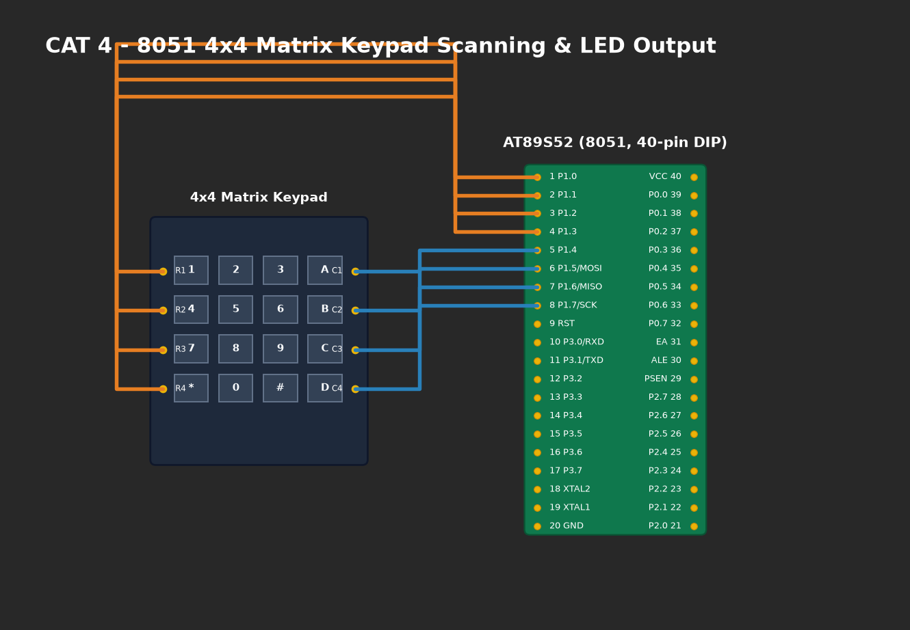

# EXPERIMENT DETAILS

**EXP:** CONTINUOUS ASSESMENT 4

**DATE:** 03/08/2026

**NAME OF EXP:** Human-Machine Interface using Matrix Keypad, LEDs, and Seven-Segment Display

**HARDWARE SETUP / PLATFORM:** AT89S52 Microcontroller + 4x4 Matrix Keypad (Port 2) + 7-Segment Display (Port 0) + 4 LEDs (Port 1) + Keil µVision C51

---

## TASK 4A : Matrix Keypad Scanning and Seven-Segment Output
The 4x4 matrix keypad is scanned using row-drive column-read technique. When any numeric key is pressed, its decoded integer value is presented on the Common-Cathode 7-segment display.

## TASK 4B : Keypad-Triggered Multi-Mode LED Control
The system executes dedicated hardware actions based on key codes:
- **Key 1:** LED1 ON (`0x01`)
- **Key 2:** LED2 ON (`0x02`)
- **Key 3:** LED3 ON (`0x04`)
- **Key 4:** LED4 ON (`0x08`)
- **Key 5:** Running LED Pattern (`0x01 -> 0x02 -> 0x04 -> 0x08`)
- **Key 6:** Alternate LEDs (`1010` <-> `0101`)
- **Key 7:** 4-Bit Binary Counter (`0000` to `1111`)
- **Key 8:** All LEDs Blink
- **Key 9:** All LEDs OFF / System Reset

---

### 1. Circuit Diagram

- **Microcontroller:** AT89S52 (DIP-40)
- **Keypad Matrix (Port 2):** Rows connected to `P2.0–P2.3` (driven LOW sequentially); Columns connected to `P2.4–P2.7` with internal/external pull-ups.
- **7-Segment Display (Port 0):** Common-Cathode segments (a–g) connected to `P0.0–P0.6` via a 10kΩ pull-up resistor network (Port 0 open-drain output).
- **LED Indicators (Port 1):** 4 active-high LEDs connected to `P1.0–P1.3` with 330Ω series resistors.
- **Power:** +5.0V DC.

### 2. Core Logic / Pseudocode / Code Base

**Working Principle:**
Port 2 scans the matrix by asserting each row LOW and reading column inputs. A matrix lookup maps active intersections to numeric keys. The 7-segment decoder table (`seg_code`) outputs segment configurations to Port 0. A switch-case dispatcher drives Port 1 outputs according to the pressed key.

**Pseudocode:**
1. Initialize Port 0 as output and Port 2 as keypad interface.
2. In `keypad_scan()`:
   - For each row 0 to 3: Drive row bit LOW (`0xFE, 0xFD, 0xFB, 0xF7`).
   - Read upper nibble `P2 >> 4`.
   - If column bit is LOW, debounce and return `key_matrix[row][col]`.
3. In `main()`:
   - Call `keypad_scan()`.
   - If key valid: `display_digit(key)` and execute `led_control(key)`.

### 3. Inference
- Matrix scanning reduced 16 discrete keys to 8 I/O lines.
- Port 0 open-drain outputs functioned properly with external 10kΩ pull-up resistor array.
- HMI integrated visual digit feedback with immediate actuation of 9 distinct LED states.
