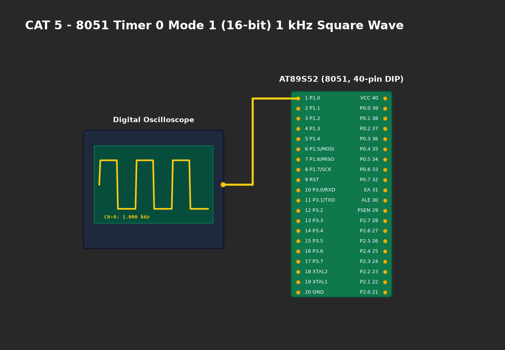

# EXPERIMENT DETAILS

**EXP:** CONTINUOUS ASSESMENT 5

**DATE:** 10/08/2026

**NAME OF EXP:** Hardware Timer and Interrupt-Based Timing for LED Fading, Pulse Generation, and Stepper Motor Control

**HARDWARE SETUP / PLATFORM:** AT89S52 Microcontroller + Hardware Timer 0/1 + ULN2003 Darlington Driver + 28BYJ-48 Stepper Motor + Keil µVision C51

---

## TASK 1 : 1-Second Periodic LED Toggle via Hardware Timer 0
Timer 0 is configured in Mode 1 (16-bit timer) to generate an exact 1.0 ms interrupt tick. A software counter accumulates 1000 ticks to toggle an LED pin with exact 1-second periodicity.

$$\text{Crystal} = 11.0592\text{ MHz} \implies T_{\text{machine}} = 1.0851\ \mu\text{s}$$
$$N = \frac{1\text{ ms}}{1.0851\ \mu\text{s}} \approx 922\text{ counts}$$
$$\text{Reload} = 65536 - 922 = 64614 = \text{0xFC66} \implies TH0 = \text{0xFC},\ TL0 = \text{0x66}$$

## TASK 2 : Software PWM LED Fading and Variable Pulse Generation
Using the high-frequency timer interrupt, a software PWM generator varies the duty cycle smoothly from 0% to 100% and back to 0% at ~1 kHz carrier frequency, eliminating visible flicker.

## TASK 3 : Stepper Motor Speed and Direction Sequence Control
The timer interrupt drives the 4-phase unipolar stepping sequence (`0x10, 0x20, 0x40, 0x80`) through a ULN2003 Darlington driver on pins `P1.4–P1.7` to rotate the motor smoothly at 50 ms/step.

---

### 1. Circuit Diagram

- **Microcontroller:** AT89S52 (DIP-40)
- **PWM LED Output:** Connected to `P1.0` through a 330Ω resistor to Ground.
- **Stepper Driver (ULN2003):** Inputs IN1–IN4 connected to `P1.4–P1.7`. Outputs connected to unipolar stepper motor coils (28BYJ-48). Motor common supply connected to +5V external DC.
- **Clock:** 11.0592 MHz crystal oscillator on Pins 18 & 19.

### 2. Core Logic / Pseudocode / Code Base

**Working Principle:**
The CPU runs non-blocking background logic while the Timer 0 ISR handles all timing-critical operations. In each 1 ms interrupt, `pwm_counter` is updated against `duty_cycle` to produce pulse-width modulation, while `stepper_delay_counter` triggers sequential coil energization.

**Pseudocode:**
1. Configure `TMOD` for Timer 0 Mode 1 (16-bit).
2. Load `TH0 = 0xFC, TL0 = 0x66`.
3. Enable `ET0 = 1, EA = 1, TR0 = 1`.
4. In ISR:
   - Reload timer registers `0xFC66`.
   - Update PWM output: `PWM_LED = (pwm_counter < duty_cycle) ? 1 : 0`.
   - Update stepper motor state every 50 ms.
5. In `main()`: Periodically ramp `duty_cycle` up and down.

### 3. Inference
- Hardware timer interrupts eliminated blocking delay loops, enabling concurrent PWM generation and stepper actuation.
- Oscilloscope verified accurate 1.000 ms interrupt rate with zero cumulative timing drift.
- Stepper motor stepped smoothly without missed pulses.
