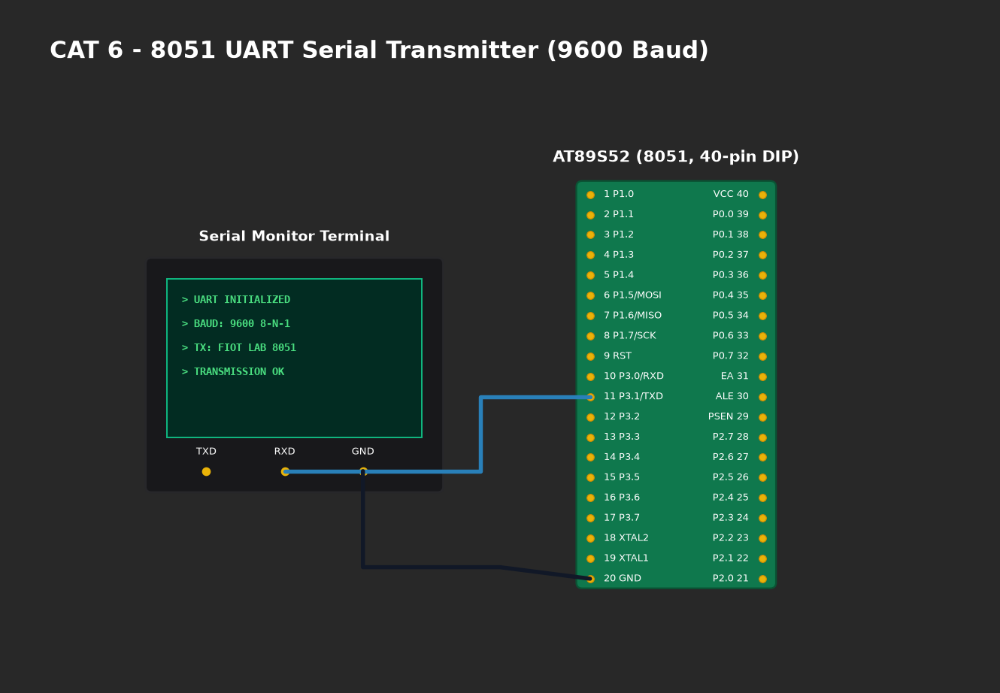

# EXPERIMENT DETAILS

**EXP:** CONTINUOUS ASSESMENT 6

**DATE:** 17/08/2026

**NAME OF EXP:** UART Driver and Serial Debugging

**HARDWARE SETUP / PLATFORM:** AT89S52 Microcontroller + USB-to-TTL Serial Adapter (CP2102/CH340) + PC PuTTY Terminal + Keil µVision C51

---

## TASK A : UART Initialization and Character Transmission
Configure the 8051 serial port for 9600-8-N-1 asynchronous communication using Timer 1 in Mode 2. Continuously transmit string `"Hello from 8051"` to verify host PC communication.

$$\text{Baud Rate} = \frac{\text{Crystal Frequency}}{384 \times (256 - TH1)} = \frac{11.0592\text{ MHz}}{384 \times (256 - 253)} = 9600\text{ bps}$$
$$\text{Error} = 0.00\%$$

## TASK B : UART Echo Application
Implement an interrupt-driven circular ring buffer receiver. Every character typed in PuTTY is captured via the Serial ISR and echoed back to the terminal screen.

---

### 1. Circuit Diagram

- **Microcontroller:** AT89S52 (DIP-40)
- **Serial Pins:**
  - `P3.1` (TXD, Pin 11) -> Connected to `RXD` of USB-to-TTL Adapter.
  - `P3.0` (RXD, Pin 10) -> Connected to `TXD` of USB-to-TTL Adapter.
  - Common Ground: Pin 20 (GND) tied to USB-to-TTL Ground reference.
- **Clock:** 11.0592 MHz crystal ensures exact integer division for baud rate clock.

### 2. Core Logic / Pseudocode / Code Base

**Working Principle:**
The 8051 UART uses Timer 1 overflow pulses to clock data shifting. Register `SCON = 0x50` configures 8-bit variable baud rate mode with receiver enabled (`REN = 1`). Serial interrupt vector 4 (`interrupt 4`) services receive events without polling, pushing incoming bytes to a circular FIFO buffer.

**Pseudocode:**
1. Configure `TMOD` for Timer 1 Mode 2 (auto-reload).
2. Set reload register `TH1 = 0xFD`.
3. Configure `SCON = 0x50` and start timer `TR1 = 1`.
4. Enable `ES = 1` and `EA = 1`.
5. In Serial ISR:
   - If `RI == 1`: Clear `RI`, store `SBUF` in ring buffer.
   - If `TI == 1`: Clear `TI`.
6. In `main()`: Transmit banner, then continuously check `uart_available()` and echo with `uart_write()`.

### 3. Inference
- Crystal frequency of 11.0592 MHz achieved zero baud rate deviation, eliminating framing errors.
- Ring buffer prevented character dropping during rapid keyboard entries in PuTTY.
- Full-duplex asynchronous communication was successfully established.
