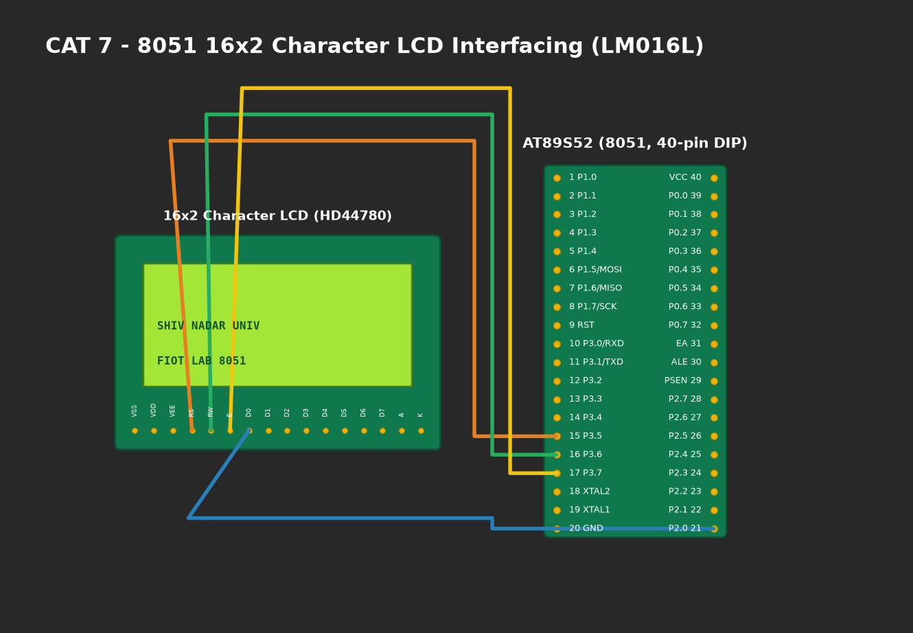

# EXPERIMENT DETAILS

**EXP:** CONTINUOUS ASSESMENT 7

**DATE:** 24/08/2026

**NAME OF EXP:** 16x2 LCD Driver Development and Dynamic Display Control

**HARDWARE SETUP / PLATFORM:** AT89S52 Microcontroller + HD44780 16x2 Character LCD + 4x4 Keypad + Keil µVision C51

---

## TASK 7A : 4-Bit GPIO LCD Driver Initialization and Character/String Display
Develop a modular low-level driver deriving the required HD44780 command sequence for 4-bit, 2-line mode. Implement `lcd_init()`, `lcd_cmd()`, and `lcd_data()`.

## TASK 7B : Cursor Positioning and Dynamic Numeric Value Display
Implement 2D coordinate addressing `lcd_goto(row, column)`, string rendering `lcd_puts(str)`, and decimal integer conversion `lcd_print_number(val)`.

## TASK 7C : Interactive 4x4 Keypad Character Navigation
Develop an interactive application allowing a marker character (`*`) to be freely navigated across the 32 screen coordinates (`16 columns x 2 rows`) using keypad navigation buttons (2: Up, 8: Down, 4: Left, 6: Right).

---

### 1. Circuit Diagram

- **Microcontroller:** AT89S52 (DIP-40)
- **16x2 LCD Control (Port 2):**
  - `RS` (Register Select) connected to `P2.0`.
  - `EN` (Enable Strobe) connected to `P2.1`.
  - `RW` (Read/Write) connected to `GND` (write-only mode).
  - `D4–D7` connected to `P2.4–P2.7`.
  - `VO` (Contrast pin 3) connected to wiper of 10kΩ potentiometer.
- **Keypad Matrix (Port 0):** Input navigation keys connected to `P0.0–P0.3` with pull-up resistors.

### 2. Core Logic / Pseudocode / Code Base

**Working Principle:**
In 4-bit mode, each 8-bit command or data byte is split into two consecutive 4-bit transfers (upper nibble first, followed by lower nibble). The `EN` line is pulsed HIGH for at least 450 ns to latch each nibble into the HD44780 controller. The DDRAM base address is `0x80` for Row 0 and `0xC0` for Row 1.

**Command Sequence:**
1. Power-on delay > 15 ms.
2. Function Set sequence: send `0x30`, `0x30`, `0x30`, `0x20` to force 4-bit mode.
3. Command `0x28`: 4-bit mode, 2 display lines, 5x8 font.
4. Command `0x0C`: Display ON, cursor OFF.
5. Command `0x06`: Increment cursor position.
6. Command `0x01`: Clear display.

### 3. Inference
- 4-bit mode halved the required GPIO pin overhead from 8 pins to 4 pins while maintaining full HD44780 command compatibility.
- Precise pulse timing on `EN` line achieved reliable data latching without timing violations.
- Character navigation across the 16x2 display proved real-time cursor repositioning without display corruption.
