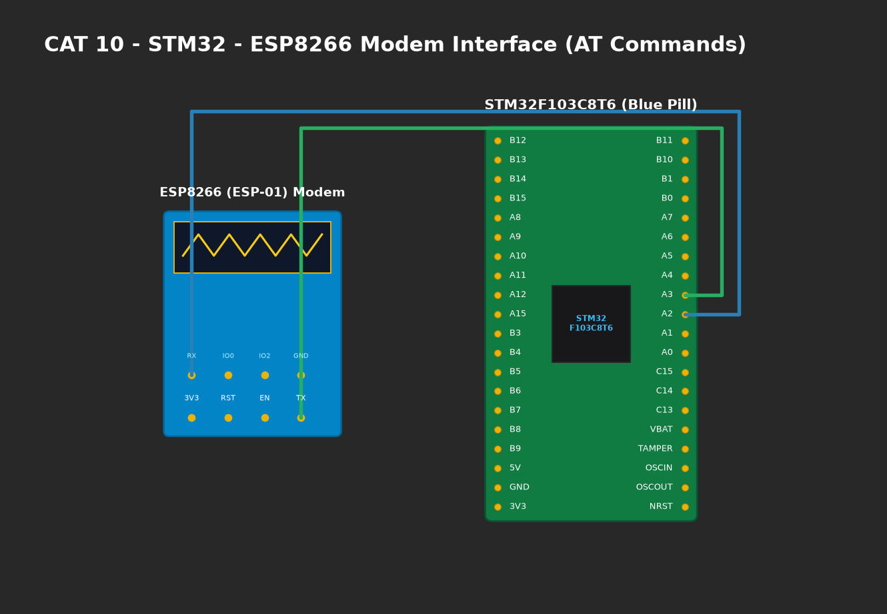

# EXPERIMENT DETAILS

**EXP:** CONTINUOUS ASSESMENT 10

**DATE:** 05/10/2026

**NAME OF EXP:** STM32-Wemos Wi-Fi Modem Interface Using AT Commands

**HARDWARE SETUP / PLATFORM:** CubeMX + Keil MDK + STM32 Blue Pill + Wemos D1 Mini (ESP8266)

---

## TASK 9A : Establish STM32 → Wemos UART Communication

### 1. Circuit Diagram
- **STM32 Blue Pill:** STM32F103C8T6
- **Wemos D1 Mini:** ESP8266 Wi-Fi Modem
- **Wiring:**
  - `PA2` (USART2_TX) -> Connected to Wemos `RX`.
  - `PA3` (USART2_RX) -> Connected to Wemos `TX`.
  - Common GND reference rail.
  - Power: 5V / 3.3V rail.



### 2. Core Logic / Pseudocode / Code Base

**Working Principle:**
The STM32 transmits attention test string `AT\r\n` across USART2 at 115200 baud. The ESP8266 parses the command and returns `OK\r\n`, proving the physical serial interconnect and baud rate synchronization are correct.

**Pseudocode:**
1. Configure USART2 at 115200 baud.
2. Transmit `AT\r\n` via `HAL_UART_Transmit()`.
3. Receive response into buffer via `HAL_UART_Receive()`.
4. Verify response contains string `OK`.

**Code Base Snippet:**
```c
Wemos_SendCommand("AT\r\n");
if (strstr((char*)rx_buf, "OK") != NULL) {
    HAL_GPIO_WritePin(GPIOC, GPIO_PIN_13, GPIO_PIN_RESET); /* Link OK */
}
```

### 3. Inference
- Verified clean electrical interconnection between STM32 and ESP8266 without logic level conversion issues.
- Confirmed ESP8266 AT firmware is running and responsive.
