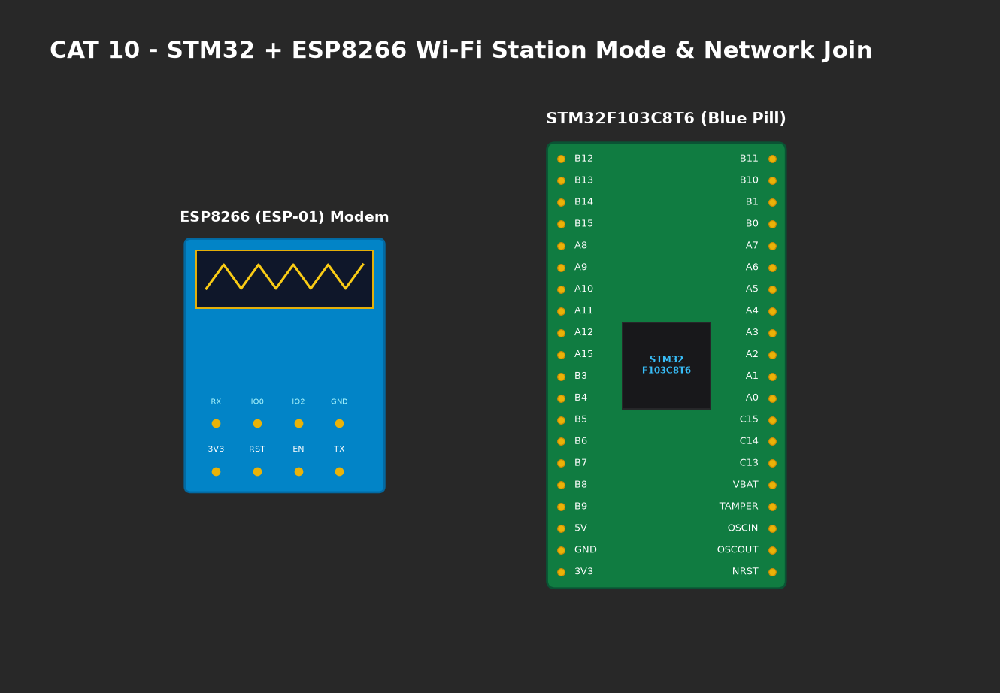

# EXPERIMENT DETAILS

**EXP:** CONTINUOUS ASSESMENT 10

**DATE:** 05/10/2026

**NAME OF EXP:** STM32-Wemos Wi-Fi Modem Interface Using AT Commands

**HARDWARE SETUP / PLATFORM:** CubeMX + Keil MDK + STM32 Blue Pill + Wemos D1 Mini (ESP8266)

---

## TASK 9B : Explore ESP8266 AT Command Interface

### 1. Circuit Diagram
STM32F103 connected to Wemos D1 Mini over USART2 (`PA2 TX`, `PA3 RX`).



### 2. Core Logic / Pseudocode / Code Base

**Working Principle:**
Issues standard Hayes diagnostic and RF configuration AT commands:
- `AT+GMR`: Queries firmware version, bootloader release, and SDK version.
- `AT+CWMODE=1`: Configures Wi-Fi operating mode as Station (Client).
- `AT+CWLAP`: Initiates 2.4 GHz RF beacon scan and returns list of visible Access Points.

**Pseudocode:**
1. Transmit `AT+GMR\r\n` and inspect version string.
2. Transmit `AT+CWMODE=1\r\n` to configure station mode.
3. Transmit `AT+CWLAP\r\n` to list nearby SSID broadcasts.

**Code Base Snippet:**
```c
Wemos_SendCommand("AT+GMR\r\n");
Wemos_SendCommand("AT+CWMODE=1\r\n");
Wemos_SendCommand("AT+CWLAP\r\n");
```

### 3. Inference
- Retrieved ESP8266 AT version (v1.7.4.0) and Espressif SDK build details.
- Verified successful discovery of campus 2.4 GHz access point beacons.
