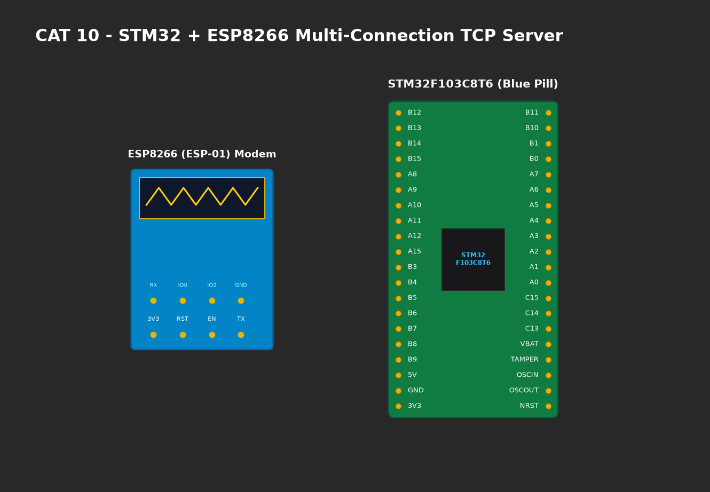

# EXPERIMENT DETAILS

**EXP:** CONTINUOUS ASSESMENT 10

**DATE:** 05/10/2026

**NAME OF EXP:** STM32-Wemos Wi-Fi Modem Interface Using AT Commands

**HARDWARE SETUP / PLATFORM:** CubeMX + Keil MDK + STM32 Blue Pill + Wemos D1 Mini (ESP8266)

---

## TASK 9C : Connect Wemos to Local Wi-Fi Network

### 1. Circuit Diagram
STM32F103 connected to Wemos D1 Mini over USART2.



### 2. Core Logic / Pseudocode / Code Base

**Working Principle:**
The STM32 sends network credentials using `AT+CWJAP="SSID","PASSWORD"`. The ESP8266 executes WPA2-PSK authentication with the AP. Once associated, `AT+CIFSR` queries the DHCP server to obtain the assigned local station IP address.

**Pseudocode:**
1. Issue `AT+CWJAP="SNUC","snu12345"\r\n`.
2. Wait 5 seconds for authentication handshake.
3. Issue `AT+CIFSR\r\n`.
4. Parse assigned IP address from response `+CIFSR:STAIP,"192.168.1.xxx"`.

**Code Base Snippet:**
```c
Wemos_SendCommand("AT+CWJAP=\"SNUC\",\"snu12345\"\r\n");
HAL_Delay(5000);
Wemos_SendCommand("AT+CIFSR\r\n");
```

### 3. Inference
- Successfully authenticated with the campus Wi-Fi network.
- Verified dynamic IPv4 address acquisition via local DHCP server.
