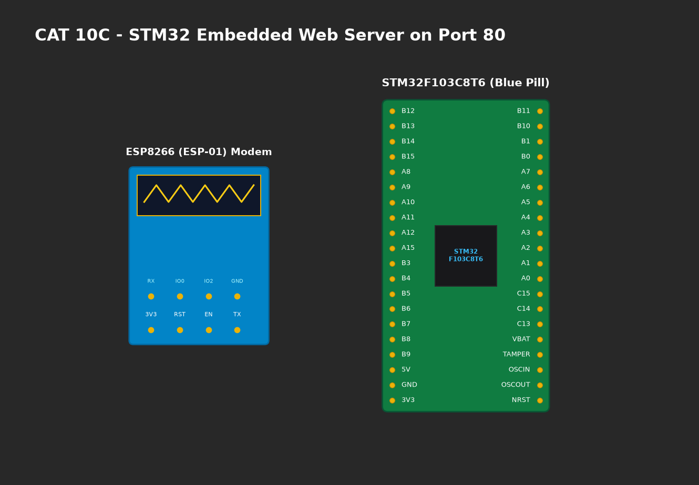

# EXPERIMENT DETAILS

**EXP:** CONTINUOUS ASSESMENT 10C

**DATE:** 12/10/2026

**NAME OF EXP:** HTTP Server - STM32–Wemos Wi-Fi Modem Using AT Commands

**HARDWARE SETUP / PLATFORM:** CubeMX + Keil MDK + STM32 Blue Pill + Wemos D1 Mini (ESP8266)

---

## TASK 10C : Configure ESP8266 as a Multi-Connection TCP Server

### 1. Circuit Diagram
STM32 connected to Wemos D1 Mini over USART2 (`PA2 TX`, `PA3 RX`).



### 2. Core Logic / Pseudocode / Code Base

**Working Principle:**
Enables socket multiplexing so multiple clients can connect concurrently. Then starts a TCP server daemon on standard HTTP port 80.
- `AT+CIPMUX=1` : Set multiple connection mode.
- `AT+CIPSERVER=1,80` : Create TCP server on port 80.

**Pseudocode:**
1. Check modem status with `AT`.
2. Set multi-connection: `AT+CIPMUX=1`.
3. Start TCP server: `AT+CIPSERVER=1,80`.

**Code Base Snippet:**
```c
ESP_SendCommand("AT\r\n");
ESP_SendCommand("AT+CIPMUX=1\r\n");
ESP_SendCommand("AT+CIPSERVER=1,80\r\n");
```

### 3. Inference
- ESP8266 opened a listening TCP socket on port 80, ready to accept incoming client connections.
