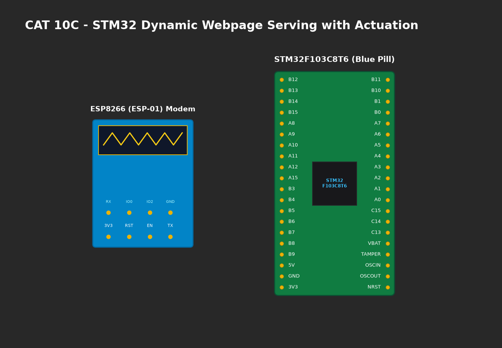

# EXPERIMENT DETAILS

**EXP:** CONTINUOUS ASSESMENT 10C

**DATE:** 12/10/2026

**NAME OF EXP:** HTTP Server - STM32–Wemos Wi-Fi Modem Using AT Commands

**HARDWARE SETUP / PLATFORM:** CubeMX + Keil MDK + STM32 Blue Pill + Wemos D1 Mini + PC Web Browser

---

## TASK 10D : Capture HTTP Request (+IPD) and Construct Static HTTP Response

### 1. Circuit Diagram
STM32 Blue Pill communicating with ESP8266 serving web clients over local Wi-Fi.



### 2. Core Logic / Pseudocode / Code Base

**Working Principle:**
When a browser visits `http://<IP>/`, the ESP8266 delivers `+IPD,<link_id>,<len>:GET / HTTP/1.1`. The STM32 parses `link_id`, formats a static HTML page, calculates `Content-Length`, sends `AT+CIPSEND=<link_id>,<len>`, streams the HTTP/1.1 200 OK headers and body, and terminates the socket with `AT+CIPCLOSE`.

**Pseudocode:**
1. Monitor USART2 for `+IPD,` prefix.
2. Extract `link_id`.
3. Format HTTP response with HTML body.
4. Transmit `AT+CIPSEND=<link_id>,<len>`.
5. Transmit response string.
6. Transmit `AT+CIPCLOSE=<link_id>`.

**Code Base Snippet:**
```c
char *p = strstr((char*)rx_buf, "+IPD,");
if (p != NULL) {
    int link_id = 0;
    sscanf(p, "+IPD,%d,", &link_id);
    Serve_HTTP_Response(link_id);
}
```

### 3. Inference
- Web browser connected and rendered the web page ("STM32 IoT Node") immediately.
- Valid RFC 2616 headers ensured immediate rendering without socket hang.
