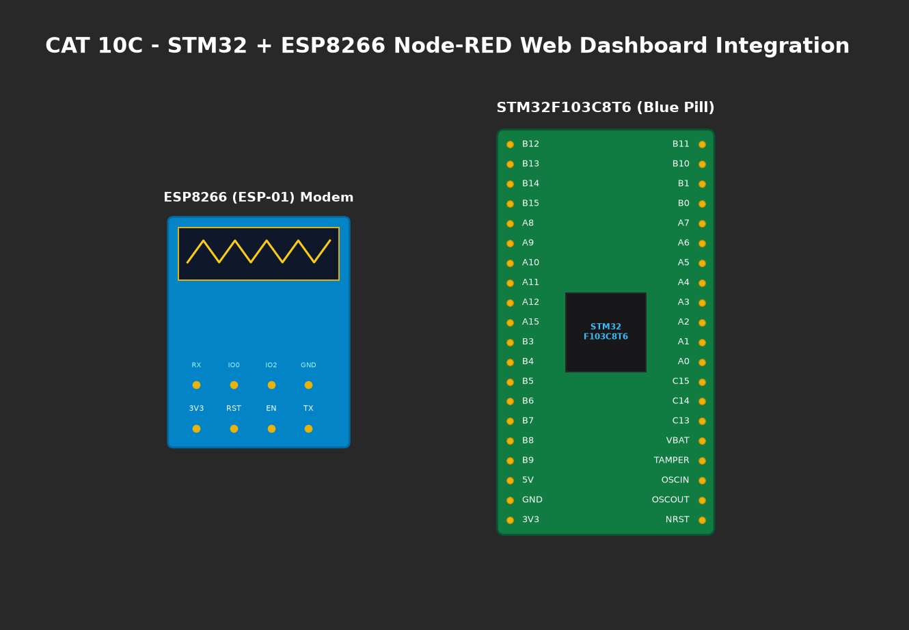

# EXPERIMENT DETAILS

**EXP:** CONTINUOUS ASSESMENT 10C

**DATE:** 12/10/2026

**NAME OF EXP:** HTTP Server - STM32–Wemos Wi-Fi Modem Using AT Commands

**HARDWARE SETUP / PLATFORM:** CubeMX + Keil MDK + STM32 Blue Pill + ESP8266 + Node-RED

---

## TASK 10E : Node-RED HTTP Client Integration

### 1. Circuit Diagram
STM32 HTTP server integrated with Node-RED client over Wi-Fi.

### 2. Core Logic / Pseudocode / Code Base

**Working Principle:**
A Node-RED flow is configured with an `inject` node triggering an `http request` GET node pointed at `http://<ESP8266_IP>/`. The received HTML payload is displayed in the debug panel, proving automated machine-to-machine HTTP communication.

**Node-RED Configuration:**
- **Trigger:** Inject node (Interval: every 5 seconds).
- **Method:** `GET`.
- **URL:** `http://192.168.1.105/`.
- **Output:** Debug node (`msg.payload`).

### 3. Inference
- Verified that both human browser clients and automated IoT software (Node-RED) can interact seamlessly with the STM32 web server.
