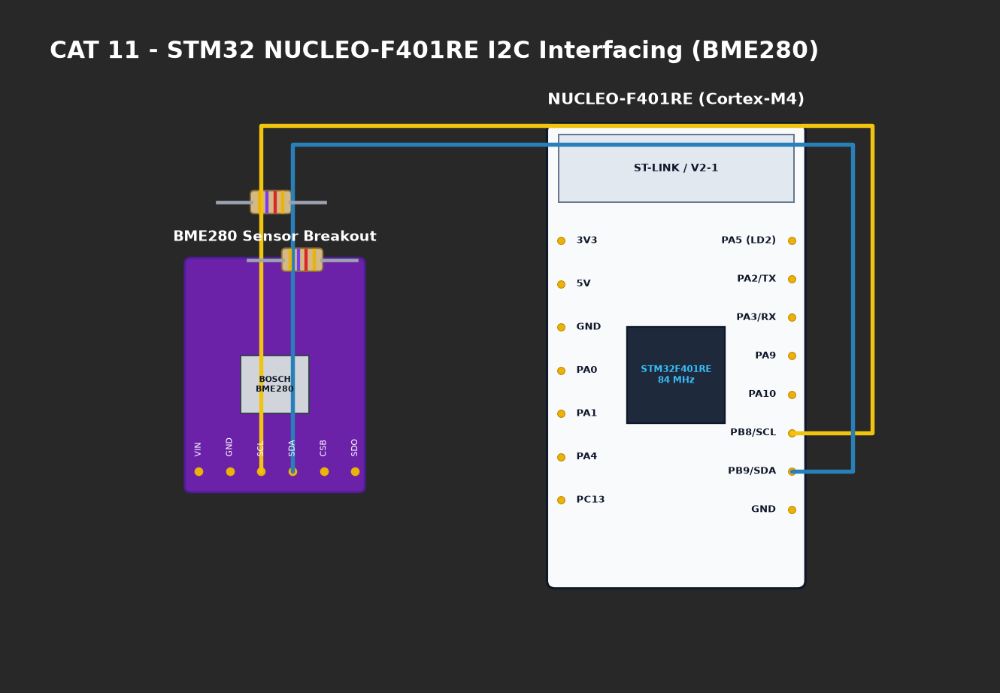

# EXPERIMENT DETAILS

**EXP:** CONTINUOUS ASSESMENT 11

**DATE:** 14/10/2026

**NAME OF EXP:** STM32F401RE Cortex-M4: GPIO and User Input Programming

**HARDWARE SETUP / PLATFORM:** CubeMX + Keil MDK + STM32 Nucleo Development Board (NUCLEO-F401RE)

---

## TASK 1 : On-Board LED Bring-Up

### 1. Circuit Diagram
- **Development Board:** STM32 NUCLEO-F401RE
- **Microcontroller:** STM32F401RET6 (ARM Cortex-M4 with FPU @ 84 MHz)
- **User LED LD2:** Connected to `PA5` with series current-limiting resistor (Active-High).
- **Clock:** 84 MHz System Clock derived from PLL.



### 2. Core Logic / Pseudocode / Code Base

**Working Principle:**
Configures pin `PA5` as GPIO Output Push-Pull via AHB1 clock enable. Uses `HAL_GPIO_TogglePin()` and `HAL_Delay(500)` to generate a symmetrical 1.0 Hz square wave.

**Pseudocode:**
1. Enable `__HAL_RCC_GPIOA_CLK_ENABLE()`.
2. Configure `PA5` as `GPIO_MODE_OUTPUT_PP`.
3. In infinite loop:
   - `HAL_GPIO_TogglePin(GPIOA, GPIO_PIN_5)`.
   - `HAL_Delay(500)`.

**Code Base Snippet:**
```c
while (1) {
    HAL_GPIO_TogglePin(GPIOA, GPIO_PIN_5);
    HAL_Delay(500);
}
```

### 3. Inference
- Confirmed STM32 Nucleo hardware bring-up and proper operation of GPIO driver on Cortex-M4 core.
