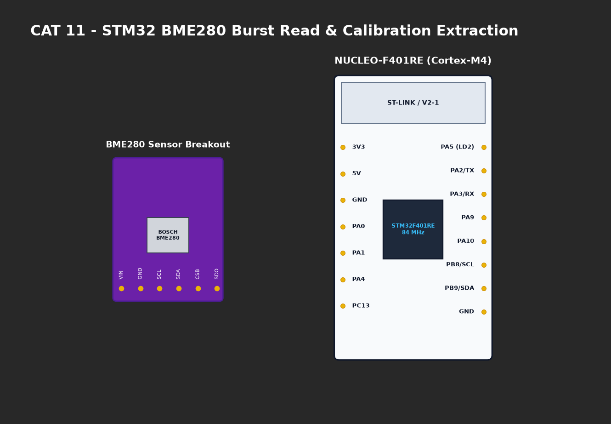

# EXPERIMENT DETAILS

**EXP:** CONTINUOUS ASSESMENT 11

**DATE:** 14/10/2026

**NAME OF EXP:** STM32F401RE Cortex-M4: GPIO and User Input Programming

**HARDWARE SETUP / PLATFORM:** CubeMX + Keil MDK + STM32 Nucleo Development Board (NUCLEO-F401RE)

---

## TASK 2 : On-Board Switch Control with State Remembrance

### 1. Circuit Diagram
- **Microcontroller:** STM32F401RET6
- **User LED LD2:** Connected to `PA5` (Active-High).
- **User Button B1:** Connected to `PC13` with onboard pull-up resistor (Active-Low).



### 2. Core Logic / Pseudocode / Code Base

**Working Principle:**
Monitors active-low push button on `PC13`. When a falling edge is detected, debounces for 25 ms, toggles `PA5`, and latches the state so that the LED remains in its new state after the button is released.

**Pseudocode:**
1. Poll `PC13`: If `RESET` and not previously pressed:
   - Debounce 25 ms.
   - Toggle `PA5` LD2 LED.
   - Set `btn_pressed = 1`.
2. When `PC13` returns to `SET`:
   - Debounce 25 ms.
   - Clear `btn_pressed = 0`.

**Code Base Snippet:**
```c
if (HAL_GPIO_ReadPin(GPIOC, GPIO_PIN_13) == GPIO_PIN_RESET && !btn_pressed) {
    HAL_Delay(25);
    HAL_GPIO_TogglePin(GPIOA, GPIO_PIN_5);
    btn_pressed = 1;
} else if (HAL_GPIO_ReadPin(GPIOC, GPIO_PIN_13) == GPIO_PIN_SET && btn_pressed) {
    HAL_Delay(25);
    btn_pressed = 0;
}
```

### 3. Inference
- Push-button input successfully toggled LED state with persistent state remembrance.
