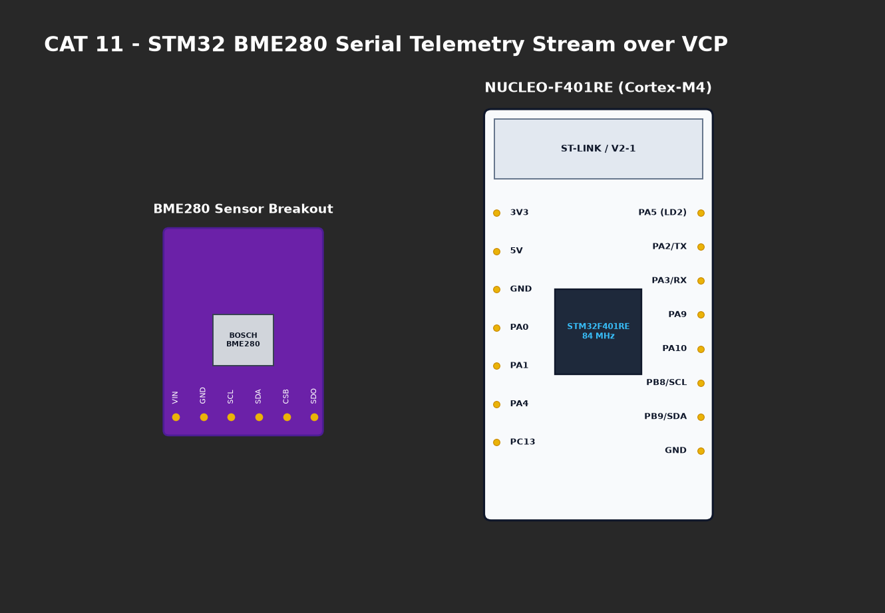

# EXPERIMENT DETAILS

**EXP:** CONTINUOUS ASSESMENT 11

**DATE:** 14/10/2026

**NAME OF EXP:** STM32F401RE Cortex-M4: GPIO and User Input Programming

**HARDWARE SETUP / PLATFORM:** CubeMX + Keil MDK + STM32 Nucleo Development Board (NUCLEO-F401RE)

---

## TASK 3 : Short-Press and Long-Press Detection

### 1. Circuit Diagram
Nucleo-F401RE board with onboard LED LD2 (`PA5`) and User Button B1 (`PC13`).



### 2. Core Logic / Pseudocode / Code Base

**Working Principle:**
Captures press timestamp using `HAL_GetTick()`. On button release, calculates press duration:
- **Short Press (< 1000 ms):** Normal toggle of LD2; disables alert mode if active.
- **Long Press (≥ 1000 ms):** Enters emergency alert mode, flashing LD2 at high frequency (80 ms period).

**Pseudocode:**
1. On press (`PC13 == RESET`): Record `press_time = HAL_GetTick()`.
2. On release (`PC13 == SET`):
   - `duration = HAL_GetTick() - press_time`.
   - If `duration < 1000`: `alert_mode = 0; HAL_GPIO_TogglePin(GPIOA, GPIO_PIN_5);`.
   - Else: `alert_mode = 1;`.
3. In loop: If `alert_mode == 1`, toggle LD2 every 80 ms non-blockingly.

**Code Base Snippet:**
```c
uint32_t duration = HAL_GetTick() - press_time;
if (duration < 1000) {
    alert_mode = 0;
    HAL_GPIO_TogglePin(GPIOA, GPIO_PIN_5);
} else {
    alert_mode = 1;
}
```

### 3. Inference
- Successfully distinguished short from long button presses using deterministic non-blocking timing thresholds.
