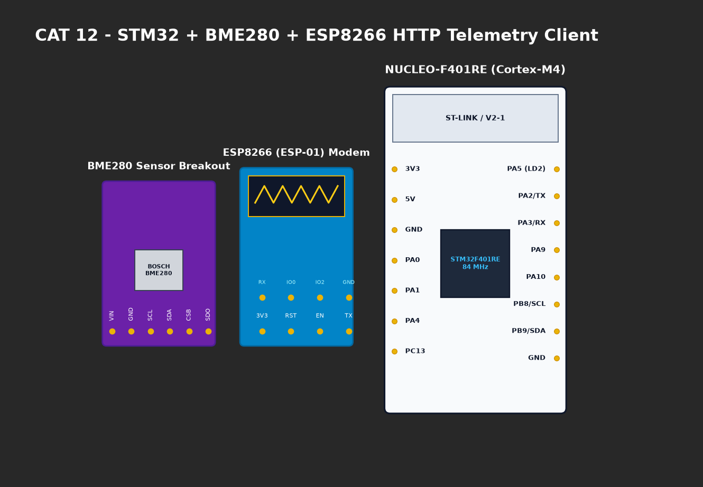

# EXPERIMENT DETAILS

**EXP:** CONTINUOUS ASSESMENT 12

**DATE:** 23/10/2026

**NAME OF EXP:** Sensor Interfacing(BME280) - STM32(Debug) - ESP8266(Wi-Fi) HTTP - Node Analytics

**HARDWARE SETUP / PLATFORM:** CubeMX + Keil MDK + STM32 Nucleo-F401RE + BME280 I2C Sensor + Bosch API

---

## TASK 12A : BME280 I2C Driver Bring-Up & Bosch API Integration

### 1. Circuit Diagram
- **Host Controller:** STM32 NUCLEO-F401RE
- **BME280 Sensor:**
  - `PB8` -> `SCL` (with 4.7kΩ pull-up to 3.3V)
  - `PB9` -> `SDA` (with 4.7kΩ pull-up to 3.3V)
  - `VCC` -> 3.3V rail, `GND` -> GND
  - `SDO` -> Tied to GND (I2C address: `0x76`).



### 2. Core Logic / Pseudocode / Code Base

**Working Principle:**
Implements hardware communication wrappers `user_i2c_read`, `user_i2c_write`, and `user_delay_us`. The Bosch Sensortec API initializes the sensor, validates Chip ID `0x60`, retrieves calibration coefficients from NVM, and computes mathematically compensated temperature, pressure, and humidity values.

**Pseudocode:**
1. Initialize I2C1 at 100 kHz standard mode.
2. Map device interface pointers to I2C wrapper functions.
3. Call `bme280_init(&dev)`.
4. Configure 1x oversampling for temperature, pressure, and humidity.
5. Set normal operating mode: `bme280_set_sensor_mode(BME280_MODE_NORMAL, &dev)`.
6. Read data: `bme280_get_sensor_data(BME280_ALL, &comp_data, &dev)`.

**Code Base Snippet:**
```c
rslt = bme280_init(&dev);
bme280_set_sensor_settings(BME280_SEL_OSR_PRESS | BME280_SEL_OSR_TEMP | BME280_SEL_OSR_HUM, &dev);
bme280_set_sensor_mode(BME280_MODE_NORMAL, &dev);
bme280_get_sensor_data(BME280_ALL, &comp_data, &dev);
```

### 3. Inference
- Verified reliable I2C communication at address `0x76`.
- Trim compensation formulas calculated accurate temperature (°C), atmospheric pressure (hPa), and humidity (%RH).
