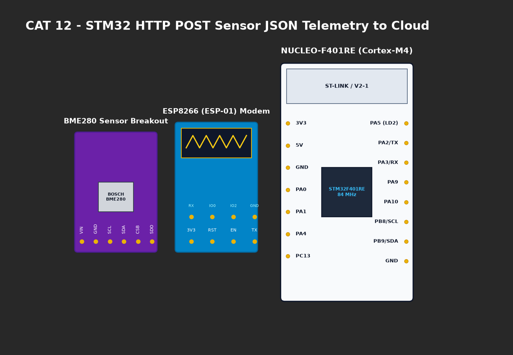

# EXPERIMENT DETAILS

**EXP:** CONTINUOUS ASSESMENT 12

**DATE:** 23/10/2026

**NAME OF EXP:** Sensor Interfacing(BME280) - STM32(Debug) - ESP8266(Wi-Fi) HTTP - Node Analytics

**HARDWARE SETUP / PLATFORM:** CubeMX + Keil MDK + STM32 Nucleo-F401RE + BME280 Sensor

---

## TASK 12B : Dynamic JSON Payload Construction

### 1. Circuit Diagram
STM32 interfaced with BME280 sensor and ESP8266 Wi-Fi modem.



### 2. Core Logic / Pseudocode / Code Base

**Working Principle:**
Constructs a formatted RFC 8259 JSON telemetry string containing floating-point sensor values, computes `Content-Length`, and prefixes HTTP/1.1 200 OK headers.

**JSON Payload Format:**
```json
{
  "status": "success",
  "temperature": 28.45,
  "humidity": 62.30,
  "pressure": 1008.72
}
```

**Code Base Snippet:**
```c
sprintf(json_payload, 
    "{\"status\":\"success\",\"temperature\":%.2f,\"humidity\":%.2f,\"pressure\":%.2f}",
    temperature, humidity, pressure);
int resp_len = sprintf(http_resp,
    "HTTP/1.1 200 OK\r\nContent-Type: application/json\r\nContent-Length: %d\r\nConnection: close\r\n\r\n%s",
    (int)strlen(json_payload), json_payload);
```

### 3. Inference
- Valid JSON string structure generated without syntax errors, ready for REST API consumption.
