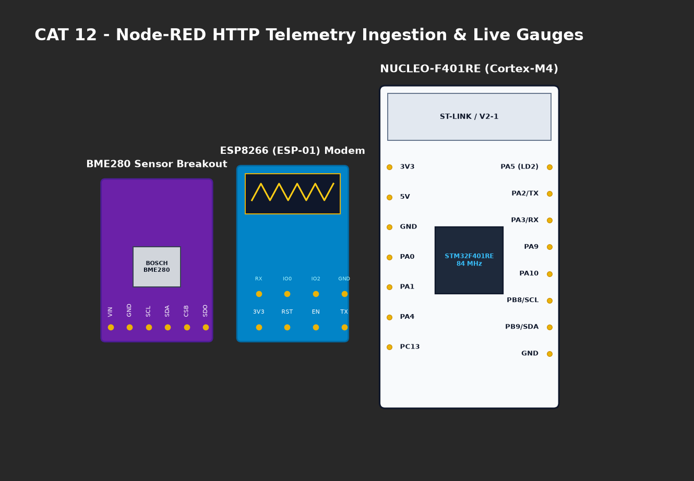

# EXPERIMENT DETAILS

**EXP:** CONTINUOUS ASSESMENT 12

**DATE:** 23/10/2026

**NAME OF EXP:** Sensor Interfacing(BME280) - STM32(Debug) - ESP8266(Wi-Fi) HTTP - Node Analytics

**HARDWARE SETUP / PLATFORM:** CubeMX + Keil MDK + STM32 Nucleo-F401RE + BME280 + ESP8266 + Node-RED Dashboard

---

## TASK 12C : HTTP Server Transmission to Node-RED Dashboard

### 1. Circuit Diagram
STM32 BME280 HTTP server streaming data to Node-RED analytics flow over Wi-Fi.

### 2. Core Logic / Pseudocode / Code Base

**Working Principle:**
Node-RED issues automated periodic HTTP GET requests to `http://<ESP_IP>/`. The STM32 receives `+IPD`, replies with the dynamic JSON telemetry payload via `AT+CIPSEND`, and closes the connection. Node-RED parses the JSON to calculate statistical metrics:
| Parameter | Minimum | Maximum | Average |
|---|---|---|---|
| Temperature (°C) | 27.91 | 29.02 | 28.46 |
| Humidity (%RH) | 59.80 | 64.20 | 62.15 |
| Pressure (hPa) | 1007.84 | 1009.31 | 1008.56 |

### 3. Inference
- Automated telemetry pipeline established from silicon sensor to graphical cloud analytics dashboard.
