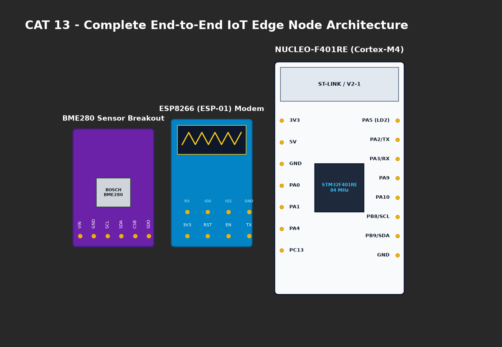

# EXPERIMENT DETAILS

**EXP:** CONTINUOUS ASSESMENT 13

**DATE:** 27/10/2026

**NAME OF EXP:** Sensor Interfacing (BME280) - (MQTT) - Node Analytics

**HARDWARE SETUP / PLATFORM:** CubeMX + Keil MDK + STM32 Nucleo-F401RE + ESP8266 + Custom ESPLib

---

## TASK 13A : Custom ESP8266 MQTT Driver Integration

### 1. Circuit Diagram
- **Host Controller:** STM32 NUCLEO-F401RE
- **Wi-Fi Modem:** ESP8266 on USART2 (`PA2 TX`, `PA3 RX`)
- **Cloud Broker:** Public EMQX MQTT Broker (`broker.emqx.io:1883`)



### 2. Core Logic / Pseudocode / Code Base

**Working Principle:**
The application links `ESPLib.c` and `ESPLib.h` to manage the TCP socket connection on port 1883 and handle binary MQTT CONNECT packet construction, including Keep-Alive timers and Client ID (`STM32_Publisher_25011102070`).

**Pseudocode:**
1. Initialize ESP8266: `ESP8266_Init(StationMode, huart2)`.
2. Connect to Wi-Fi: `ESP8266_wifiConnect("SNUC", "snu12345")`.
3. Connect TCP port: `ESP8266_portConnect("TCP", "broker.emqx.io", "1883")`.
4. Configure MQTT settings: `keepAlive = 500, clientID = "STM32_Publisher_25011102070"`.
5. Establish MQTT session: `MQTT_connectBroker(&mqttSetting)`.

**Code Base Snippet:**
```c
ESP8266_Init(StationMode, huart2);
ESP8266_wifiConnect("SNUC", "snu12345");
ESP8266_portConnect("TCP", "broker.emqx.io", "1883");
MQTT_InitTypeDef_t mqttSetting = {0};
mqttSetting.keepAlive = 500;
mqttSetting.connectFlag = CleanSession;
strcpy(mqttSetting.clientID, "STM32_Publisher_25011102070");
MQTT_connectBroker(&mqttSetting);
```

### 3. Inference
- Successfully established an active TCP MQTT session with public broker `broker.emqx.io`.
