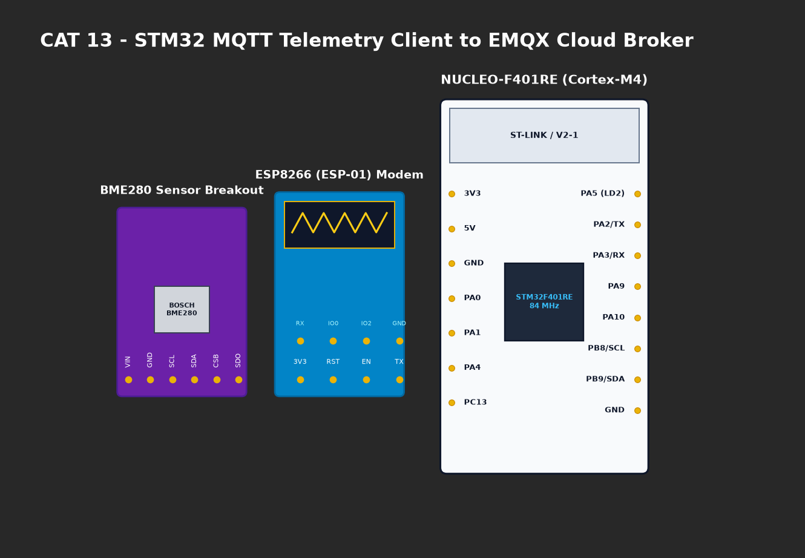

# EXPERIMENT DETAILS

**EXP:** CONTINUOUS ASSESMENT 13

**DATE:** 27/10/2026

**NAME OF EXP:** Sensor Interfacing (BME280) - (MQTT) - Node Analytics

**HARDWARE SETUP / PLATFORM:** CubeMX + Keil MDK + STM32 Nucleo-F401RE + BME280 Sensor + ESP8266

---

## TASK 13B : Environmental Telemetry Publishing to MQTT Broker

### 1. Circuit Diagram
STM32 with BME280 sensor and ESP8266 publishing telemetry over MQTT.



### 2. Core Logic / Pseudocode / Code Base

**Working Principle:**
Every 1000 ms, compensated readings from the BME280 sensor are converted into a JSON string and published to MQTT topic `stm32/ky/data` using Quality of Service level 0 (QoS 0).

**Pseudocode:**
1. Read sensor data: `bme280_get_sensor_data(BME280_ALL, &comp_data, &dev)`.
2. Format JSON telemetry payload.
3. Publish to topic: `MQTT_publishTopic("stm32/ky/data", json_payload, QoS0)`.
4. Delay 1000 ms and repeat.

**Code Base Snippet:**
```c
sprintf(json_payload, 
    "{\"status\":\"success\",\"temperature\":%.2f,\"humidity\":%.2f,\"pressure\":%.2f}",
    temperature, humidity, pressure);
MQTT_publishTopic("stm32/ky/data", json_payload, QoS0);
```

### 3. Inference
- High-efficiency publish-subscribe transmission achieved with minimal packet overhead compared to HTTP.
- Continuous 1 Hz telemetry publishing verified without packet loss.
