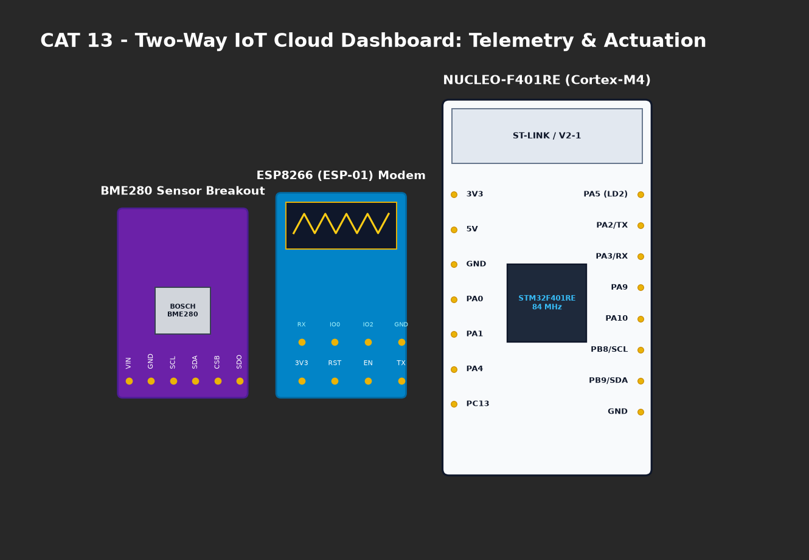

# EXPERIMENT DETAILS

**EXP:** CONTINUOUS ASSESMENT 13

**DATE:** 27/10/2026

**NAME OF EXP:** Sensor Interfacing (BME280) - (MQTT) - Node Analytics

**HARDWARE SETUP / PLATFORM:** CubeMX + Keil MDK + STM32 Nucleo-F401RE + Node-RED Dashboard

---

## TASK 13C : Node-RED MQTT Subscriber Flow and Dashboard Analytics

### 1. Circuit Diagram
MQTT Broker streaming telemetry to Node-RED subscriber dashboard.

### 2. Core Logic / Pseudocode / Code Base

**Working Principle:**
Node-RED flow uses an `mqtt in` node subscribed to `broker.emqx.io:1883` on topic `stm32/ky/data`. The incoming JSON string is parsed into individual JavaScript properties (`temperature`, `humidity`, `pressure`) that feed dashboard UI gauges and chart nodes for real-time visualization.

**Node-RED Architecture:**
- `mqtt in` node [broker.emqx.io:1883 / topic: stm32/ky/data]
- -> `json` parser node
- -> `ui_gauge` (Temperature °C)
- -> `ui_gauge` (Humidity %RH)
- -> `ui_chart` (Pressure hPa Timeseries)

### 3. Inference
- Demonstrates complete end-to-end IoT cloud architecture from low-level silicon sensors to edge analytics visualization.
