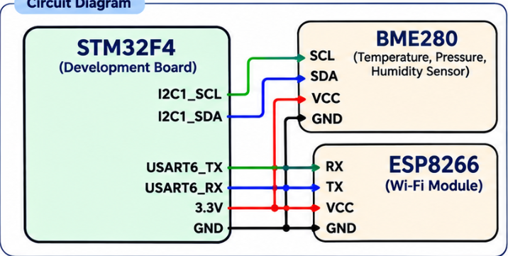
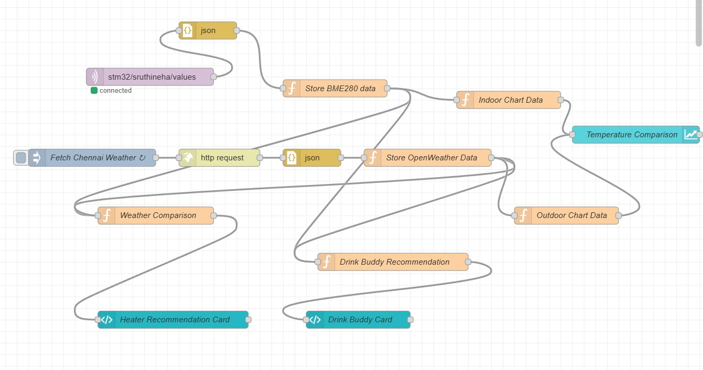
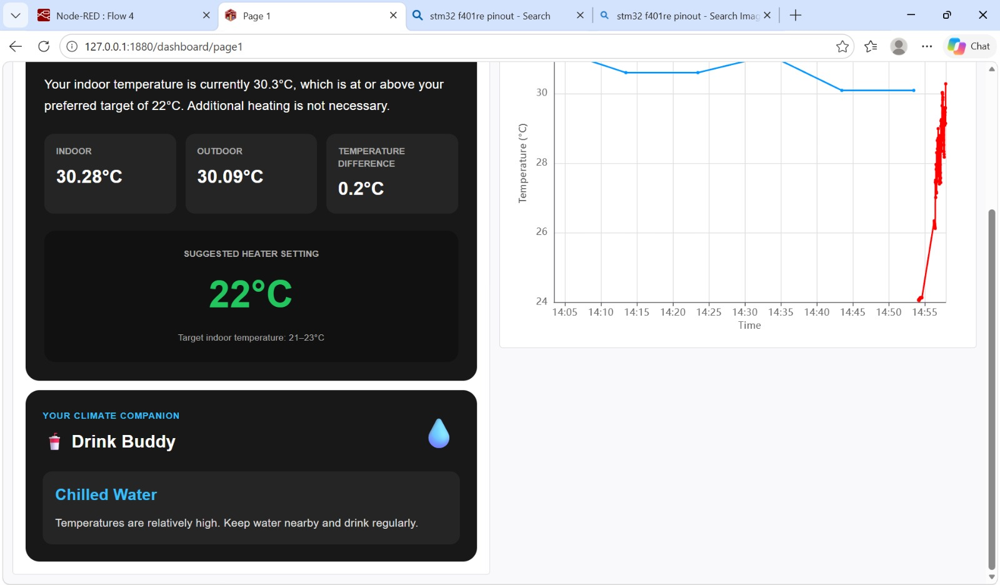

# CAT 15 – BME280 Sensor Data Publishing using MQTT

## Experiment Details

- **Experiment:** CAT 15
- **Name:** IoT Sensor Data Monitoring using BME280, STM32 and ESP8266
- **Microcontroller:** STM32F4
- **Sensor:** BME280
- **Wi-Fi Module:** ESP8266
- **Communication:** I2C and UART
- **MQTT Broker:** broker.emqx.io

## Objective

To connect a BME280 sensor to an STM32, read temperature, pressure and humidity, and publish the readings to an MQTT broker through an ESP8266 Wi-Fi module.

## Circuit Diagram



## Connections

| STM32F4 | BME280 | ESP8266 |
|---|---|---|
| I2C1_SCL | SCL | — |
| I2C1_SDA | SDA | — |
| USART6_TX | — | RX |
| USART6_RX | — | TX |
| 3.3V | VCC | VCC |
| GND | GND | GND |

## Working

1. Initialise the STM32 peripherals, including I2C1 and USART6.
2. Initialise the BME280 sensor using the BME280 library.
3. Configure the temperature, pressure and humidity oversampling.
4. Initialise the ESP8266 in Station Mode and connect it to Wi-Fi.
5. Open a TCP connection to the MQTT broker.
6. Configure the MQTT client and connect to the broker.
7. Read temperature, pressure and humidity from the BME280.
8. Format the readings as a JSON message.
9. Publish the JSON message to the MQTT topic every two seconds.

## Sensor Data

The program reads these parameters:

- Temperature (°C)
- Pressure (hPa)
- Humidity (%)

The readings are packaged into a JSON message:

```json
{
  "temperature": 28.35,
  "pressure": 1008.72,
  "humidity": 62.14
}
```

*These values are only examples; real readings depend on the sensor and its surroundings.*

## MQTT Configuration

| Parameter | Value |
|---|---|
| Broker | broker.emqx.io |
| Port | 1883 |
| Client ID | STM32_Publisher |
| Topic | stm32/shakthi/data |
| QoS | 0 |
| Keep Alive | 500 |
| Session | Clean Session |
| Publishing Interval | 2 seconds |


## Node-RED Flow

The Node-RED flow picks up the sensor data that the STM32 publishes through the MQTT broker and prepares the readings for display on a dashboard.



## Final Dashboard

The finished dashboard presents the temperature, pressure and humidity readings visually for monitoring.




## Functions Used

- `bme280_init()` – Initialises the BME280 sensor.
- `bme280_set_sensor_settings()` – Applies the sensor settings.
- `bme280_set_sensor_mode()` – Selects the sensor's operating mode.
- `bme280_get_sensor_data()` – Reads temperature, pressure and humidity.
- `user_i2c_read()` – Reads BME280 registers over I2C.
- `user_i2c_write()` – Writes BME280 registers over I2C.
- `ESP8266_Init()` – Initialises the ESP8266 module.
- `ESP8266_wifiConnect()` – Connects the ESP8266 to Wi-Fi.
- `ESP8266_portConnect()` – Opens the TCP connection.
- `MQTT_connectBroker()` – Connects to the MQTT broker.
- `MQTT_publishTopic()` – Publishes the sensor data to the MQTT topic.
- `HAL_Delay()` – Sets the two-second publishing interval.

## Inference

The STM32 reads temperature, pressure and humidity from the BME280 over I2C, converts them to JSON and publishes the result to an MQTT broker via the ESP8266 Wi-Fi module.
