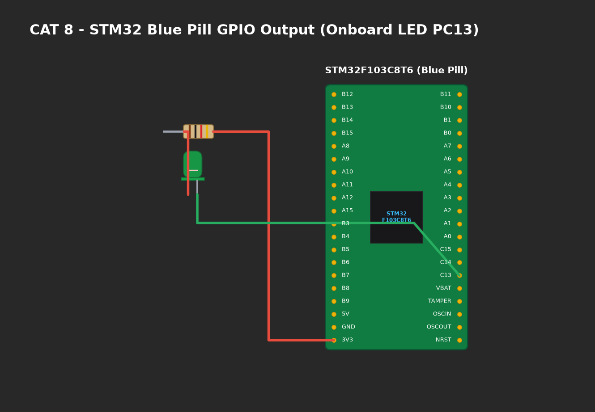

# EXPERIMENT DETAILS

**EXP:** CONTINUOUS ASSESMENT 8

**DATE:** 18/09/2026

**NAME OF EXP:** STM32 GPIO Bring-Up and Switch-Controlled LED

**HARDWARE SETUP / PLATFORM:** CubeMX + Keil MDK + STM32 Development Board Blue Pill STM32F103C8T6

---

## TASK 8A : GPIO Direct Input/Output Follower

### 1. Circuit Diagram
The circuit interfaces an external push-button switch with input pin `PA0` and the onboard LED on pin `PC13`.

- **Microcontroller:** STM32F103C8T6 (ARM Cortex-M3, 72 MHz)
- **Input Switch:** Connected to `PA0` with an external 10kΩ pull-down resistor to GND. Pressing the button pulls `PA0` HIGH (3.3V).
- **Output LED:** Onboard Green LED connected to `PC13` with current-limiting resistor tied to 3.3V rail (Active-Low: `0` = ON, `1` = OFF).
- **Power Supply:** 3.3V DC regulated rail.



### 2. Core Logic / Pseudocode / Code Base

**Working Principle:**
The firmware continually polls input pin `PA0` using `HAL_GPIO_ReadPin()`. Because the onboard LED is active-low, when the button is pressed (`GPIO_PIN_SET`), the firmware writes `GPIO_PIN_RESET` to `PC13` to illuminate the LED. When released, it writes `GPIO_PIN_SET` to extinguish the LED.

**Pseudocode:**
1. Initialize HAL library and configure GPIO clocks for Port A and Port C.
2. Configure `PC13` as Output Push-Pull.
3. Configure `PA0` as Input with Pull-Down.
4. In infinite loop:
   - Read state: `state = HAL_GPIO_ReadPin(GPIOA, GPIO_PIN_0)`.
   - Update LED: `HAL_GPIO_WritePin(GPIOC, GPIO_PIN_13, (state == GPIO_PIN_SET) ? GPIO_PIN_RESET : GPIO_PIN_SET)`.

**Code Base Snippet:**
```c
while (1) {
    if (HAL_GPIO_ReadPin(GPIOA, GPIO_PIN_0) == GPIO_PIN_SET) {
        HAL_GPIO_WritePin(GPIOC, GPIO_PIN_13, GPIO_PIN_RESET); /* LED ON */
    } else {
        HAL_GPIO_WritePin(GPIOC, GPIO_PIN_13, GPIO_PIN_SET);   /* LED OFF */
    }
}
```

### 3. Inference
- Direct register polling demonstrated zero-latency tracking of user button state.
- The active-low driver logic correctly illuminated the onboard LED upon logic HIGH button input.
