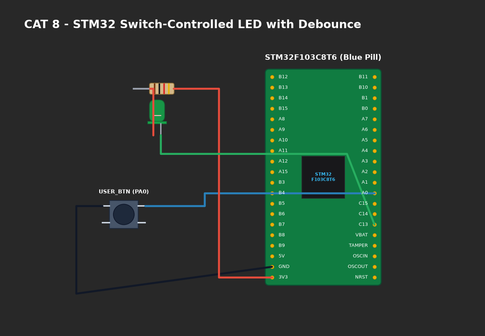

# EXPERIMENT DETAILS

**EXP:** CONTINUOUS ASSESMENT 8

**DATE:** 18/09/2026

**NAME OF EXP:** STM32 GPIO Bring-Up and Switch-Controlled LED

**HARDWARE SETUP / PLATFORM:** CubeMX + Keil MDK + STM32 Development Board Blue Pill STM32F103C8T6

---

## TASK 8B : Event-Based Debounced Switch Toggle

### 1. Circuit Diagram
The circuit interfaces the external push-button on `PA0` and the onboard LED on `PC13`.

- **Microcontroller:** STM32F103C8T6 (ARM Cortex-M3)
- **Input Switch:** Connected to `PA0` with 10kΩ pull-down resistor to GND.
- **Output LED:** Connected to `PC13` (Active-Low).
- **Power Supply:** 3.3V DC regulated rail.



### 2. Core Logic / Pseudocode / Code Base

**Working Principle:**
Mechanical switch contacts exhibit chatter/bounce during closure lasting 5–15 ms. The firmware implements edge detection combined with a 20 ms software debounce delay to ensure exactly one LED toggle event occurs per physical button depression.

**Pseudocode:**
1. Poll `PA0` for rising edge (`state == HIGH && was_pressed == 0`).
2. Delay 20 ms to allow mechanical contacts to settle.
3. If still HIGH:
   - Toggle LED: `HAL_GPIO_TogglePin(GPIOC, GPIO_PIN_13)`.
   - Set `was_pressed = 1`.
4. Wait until button is released (`state == LOW`), delay 20 ms, and clear `was_pressed = 0`.

**Code Base Snippet:**
```c
if (HAL_GPIO_ReadPin(GPIOA, GPIO_PIN_0) == GPIO_PIN_SET && !button_pressed) {
    HAL_Delay(20); /* Debounce filter */
    if (HAL_GPIO_ReadPin(GPIOA, GPIO_PIN_0) == GPIO_PIN_SET) {
        HAL_GPIO_TogglePin(GPIOC, GPIO_PIN_13);
        button_pressed = 1;
    }
} else if (HAL_GPIO_ReadPin(GPIOA, GPIO_PIN_0) == GPIO_PIN_RESET && button_pressed) {
    HAL_Delay(20);
    button_pressed = 0;
}
```

### 3. Inference
- Oscilloscope observations confirmed raw contact bounce spikes spanning 11 ms.
- The 20 ms debounce interval reliably prevented spurious multiple-toggle triggers.
- State retention across button actuations was validated.
