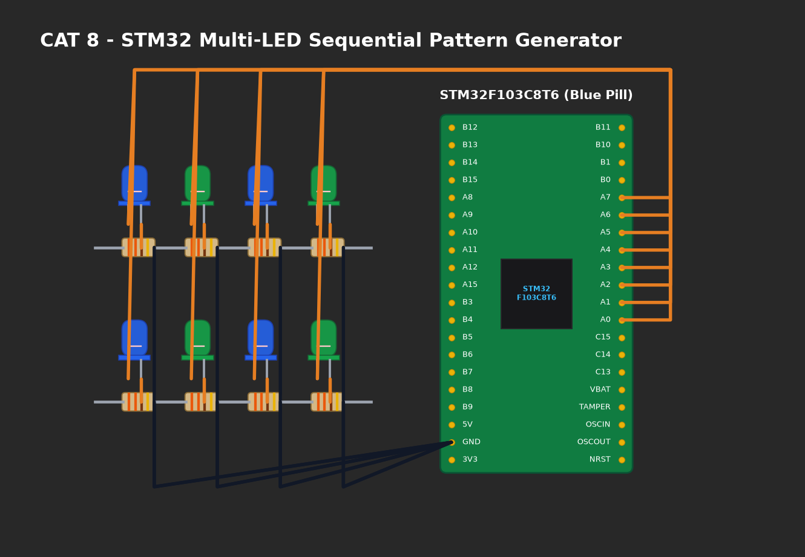

# EXPERIMENT DETAILS

**EXP:** CONTINUOUS ASSESMENT 8

**DATE:** 18/09/2026

**NAME OF EXP:** STM32 GPIO Bring-Up and Switch-Controlled LED

**HARDWARE SETUP / PLATFORM:** CubeMX + Keil MDK + STM32 Development Board Blue Pill STM32F103C8T6

---

## TASK 8C : Non-Blocking Short Press vs Long Press Detection

### 1. Circuit Diagram
Hardware setup uses `PA0` external push-button and `PC13` onboard LED.

- **Microcontroller:** STM32F103C8T6 (ARM Cortex-M3 @ 72 MHz)
- **Input Switch:** `PA0` with 10kΩ pull-down resistor.
- **Output LED:** `PC13` (Active-Low).
- **Time Base:** ARM SysTick 1 kHz hardware timer (`HAL_GetTick()`).



### 2. Core Logic / Pseudocode / Code Base

**Working Principle:**
To distinguish between short and long presses without blocking CPU execution, timestamps are captured using `HAL_GetTick()` upon press and release transitions:
- $	ext{Duration} < 1000	ext{ ms}$: Short press (Toggles LED or exits blinking mode).
- $	ext{Duration} \ge 1000	ext{ ms}$: Long press (Enters continuous 100 ms rapid blinking mode).

**Pseudocode:**
1. On press event: Record `press_start = HAL_GetTick()`.
2. On release event: Calculate `duration = HAL_GetTick() - press_start`.
3. If `duration < 1000`:
   - If currently in blinking mode, stop blinking and turn LED OFF.
   - Else, toggle LED state.
4. If `duration >= 1000`: Set `mode = BLINKING`.
5. In background loop: If `mode == BLINKING` and 100 ms elapsed, toggle LED non-blockingly.

**Code Base Snippet:**
```c
uint32_t duration = HAL_GetTick() - press_start;
if (duration < 1000) {
    if (sys_state == STATE_BLINKING) {
        sys_state = STATE_IDLE;
        HAL_GPIO_WritePin(GPIOC, GPIO_PIN_13, GPIO_PIN_SET);
    } else {
        HAL_GPIO_TogglePin(GPIOC, GPIO_PIN_13);
    }
} else {
    sys_state = STATE_BLINKING;
}
```

### 3. Inference
- Complete non-blocking implementation preserved CPU responsiveness while tracking millisecond intervals.
- User intent was cleanly classified into toggle or rapid alert blinking modes.
