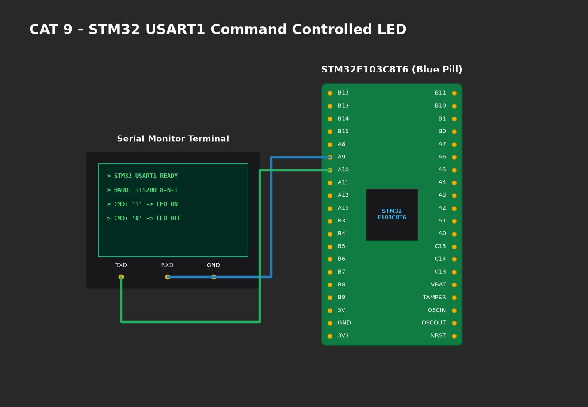

# EXPERIMENT DETAILS

**EXP:** CONTINUOUS ASSESMENT 9

**DATE:** 28/09/2026

**NAME OF EXP:** STM32 UART Command Controlled LED

**HARDWARE SETUP / PLATFORM:** CubeMX + Keil MDK + STM32 Blue Pill STM32F103C8T6 + USB-to-TTL Adapter + PuTTY Terminal

---

## TASK 9A : Basic UART Serial Communication & Echo

### 1. Circuit Diagram
- **Microcontroller:** STM32F103C8T6
- **UART Interface:** USART1
  - `PA9` (USART1_TX) -> Connected to `RXD` of USB-to-TTL Adapter.
  - `PA10` (USART1_RX) -> Connected to `TXD` of USB-to-TTL Adapter.
  - `GND` -> Connected to USB-to-TTL common ground.
- **Baud Rate:** 115200-8-N-1 (115200 baud, 8 data bits, no parity, 1 stop bit).



### 2. Core Logic / Pseudocode / Code Base

**Working Principle:**
The STM32 transmits a greeting banner via `HAL_UART_Transmit()`. In the main loop, `HAL_UART_Receive()` listens for single bytes. Each received byte is immediately echoed back over the transmitter line for visual confirmation in the host PC terminal.

**Pseudocode:**
1. Initialize USART1 peripheral with 115200 baud rate.
2. Transmit welcome string banner.
3. In loop:
   - Receive 1 byte: `HAL_UART_Receive(&huart1, &ch, 1, 10)`.
   - If received, retransmit: `HAL_UART_Transmit(&huart1, &ch, 1, 10)`.

**Code Base Snippet:**
```c
uint8_t ch;
if (HAL_UART_Receive(&huart1, &ch, 1, 10) == HAL_OK) {
    HAL_UART_Transmit(&huart1, &ch, 1, 10); /* Echo */
}
```

### 3. Inference
- Verified robust full-duplex asynchronous communication between STM32 and PC terminal at 115200 baud.
- Zero transmission framing errors observed on PuTTY.
