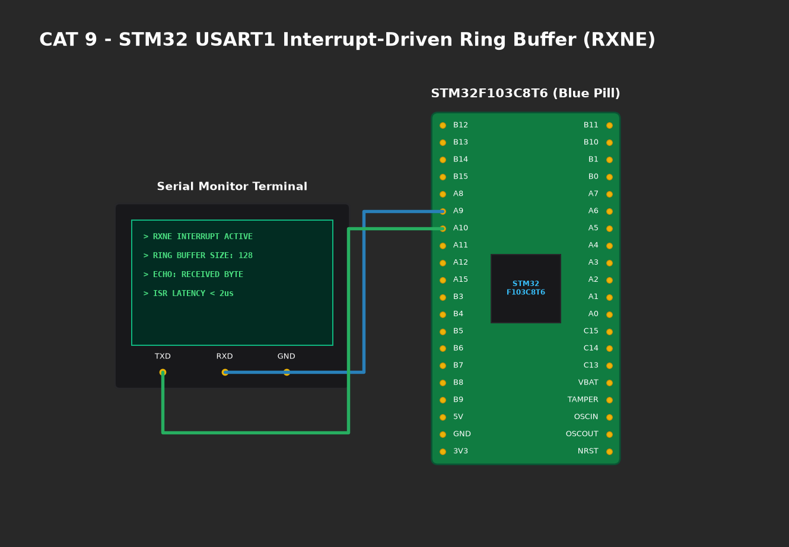

# EXPERIMENT DETAILS

**EXP:** CONTINUOUS ASSESMENT 9

**DATE:** 28/09/2026

**NAME OF EXP:** STM32 UART Command Controlled LED

**HARDWARE SETUP / PLATFORM:** CubeMX + Keil MDK + STM32 Blue Pill STM32F103C8T6 + USB-to-TTL Adapter + PuTTY Terminal

---

## TASK 9B : String-Based Command Parser

### 1. Circuit Diagram
- **Microcontroller:** STM32F103C8T6
- **USART1:** `PA9` (TX), `PA10` (RX) connected to USB-to-TTL bridge.
- **Onboard LED:** `PC13` (Active-Low).
- **PC Interface:** PuTTY Serial Terminal.



### 2. Core Logic / Pseudocode / Code Base

**Working Principle:**
Incoming characters are buffered into array `rx_buf` until a delimiter (`\r` Carriage Return or `\n` Line Feed) is detected. The string is null-terminated and compared via `strcmp()`:
- `"LED ON"` -> Drive `PC13` LOW, print `"LED turned ON\r\n> "`.
- `"LED OFF"` -> Drive `PC13` HIGH, print `"LED turned OFF\r\n> "`.
- `"LED TOGGLE"` -> Toggle `PC13`, print `"LED toggled\r\n> "`.

**Pseudocode:**
1. Read incoming character from USART1.
2. Echo character back for local display.
3. If character is `\r` or `\n`:
   - Terminate string at current index.
   - Match against command vocabulary.
   - Actuate `PC13` LED accordingly.
   - Reset buffer index to 0.
4. Else: Store in buffer.

**Code Base Snippet:**
```c
if (strcmp(rx_buf, "LED ON") == 0) {
    HAL_GPIO_WritePin(GPIOC, GPIO_PIN_13, GPIO_PIN_RESET);
    UART_SendString("LED turned ON\r\n> ");
} else if (strcmp(rx_buf, "LED OFF") == 0) {
    HAL_GPIO_WritePin(GPIOC, GPIO_PIN_13, GPIO_PIN_SET);
    UART_SendString("LED turned OFF\r\n> ");
} else if (strcmp(rx_buf, "LED TOGGLE") == 0) {
    HAL_GPIO_TogglePin(GPIOC, GPIO_PIN_13);
    UART_SendString("LED toggled\r\n> ");
}
```

### 3. Inference
- Successfully established an interactive embedded CLI for peripheral management.
- Proper handling of CR and LF ensured cross-platform terminal compatibility.
